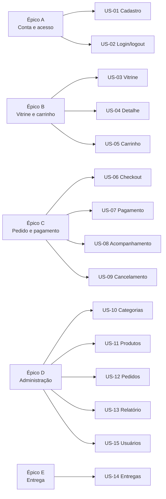

# Mapa de afinidade

Agrupamento das 15 histórias por eixo temático (épico). O objetivo é permitir entrega
incremental por valor: cada épico fecha um conjunto coerente de telas e regras.

| Épico | Histórias | Pontos | Ator principal | Valor entregue |
|---|---|---|---|---|
| A — Conta e acesso | US-01, US-02 | 5 | Cliente | Identidade e sessão segura |
| B — Vitrine e carrinho | US-03, US-04, US-05 | 13 | Cliente | Descoberta e montagem do pedido |
| C — Pedido e pagamento | US-06, US-07, US-08, US-09 | 21 | Cliente | Conversão e pós-venda |
| D — Administração | US-10, US-11, US-12, US-13, US-15 | 24 | Administrador | Operação da loja |
| E — Entrega | US-14 | 5 | Entregador | Fechamento logístico |

## Leitura do mapa

- O épico C depende de A e B (não há pedido sem cliente nem carrinho).
- O épico D depende de B (produtos e categorias alimentam a vitrine) e de C (pedidos a
  operar).
- O épico E depende de C e D (entrega só existe para pedido pago e despachado).
- A ordem de implementação segue as ondas do backlog, não a ordem alfabética dos épicos.
