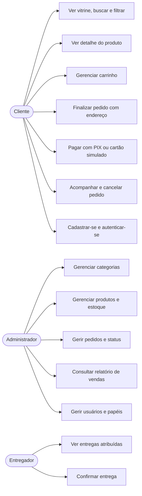
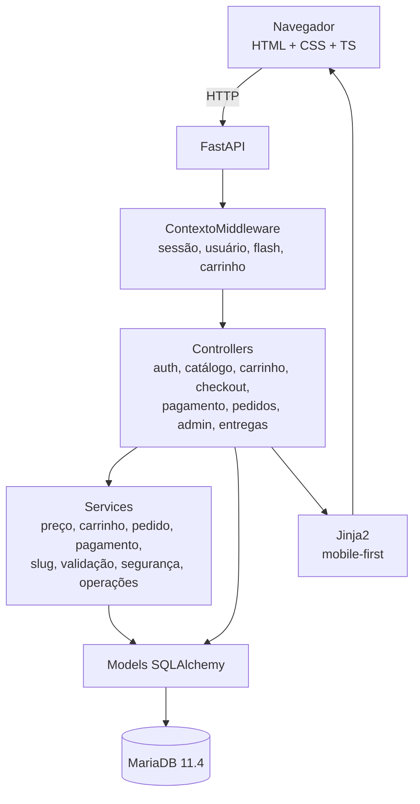
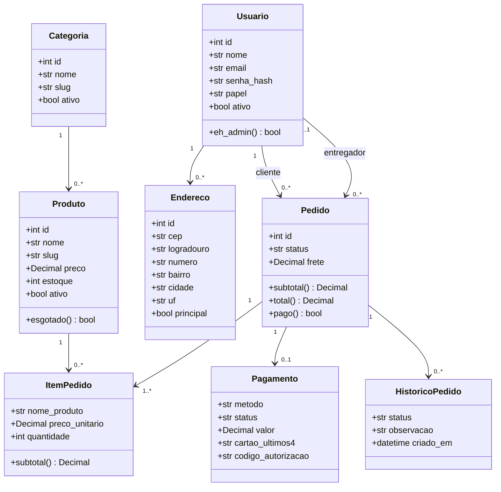
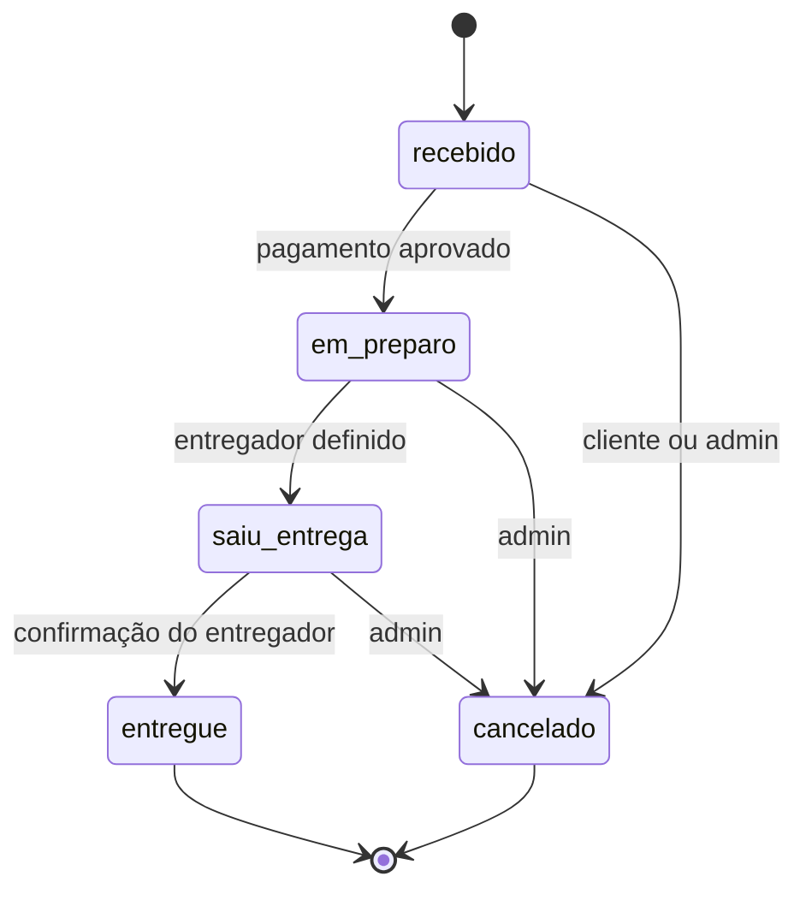
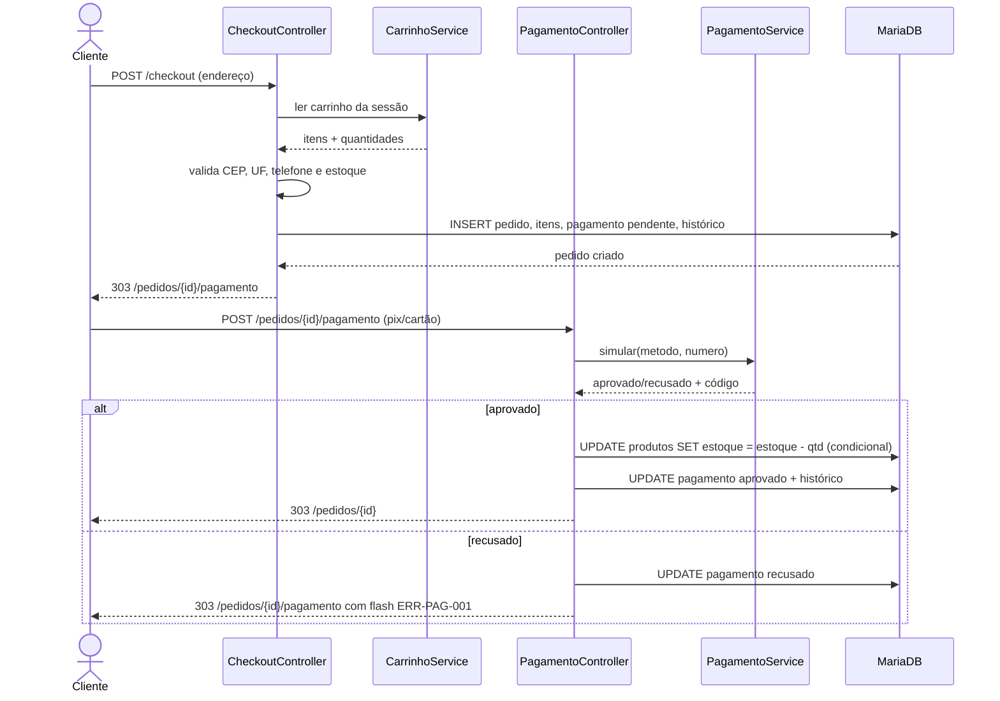

# Diagramas UML — Cupcake Gourmet 2.0

Diagramas de apoio à implementação. Todos refletem o código em `backend/app` e o
schema em `database/schema.sql`.

## Casos de uso

## Componentes (MVC)

## Classes do domínio

## Estados do pedido

## Sequência — checkout e pagamento

