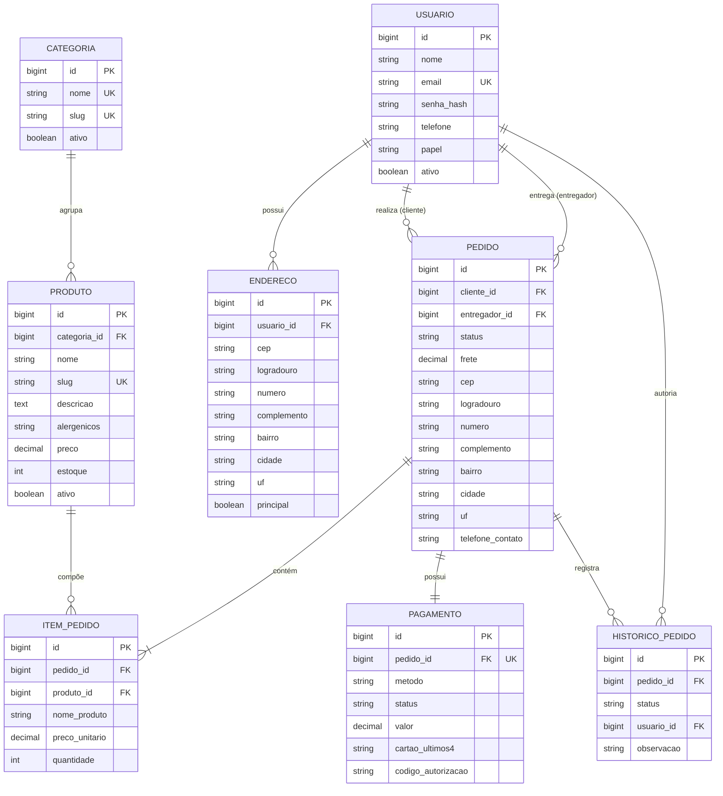

# Projeto conceitual de dados

Modelo de domínio da loja. As entidades nascem do vocabulário do negócio e dos cartões
de história; os relacionamentos têm cardinalidade explícita.

## Entidades e significado

| Entidade | Significado | Atributos-chave |
|---|---|---|
| Usuário | Pessoa que compra, entrega ou administra | Nome, e-mail único, hash de senha, papel |
| Endereço | Endereço reutilizável do cliente | CEP, logradouro, número, cidade, UF |
| Categoria | Eixo de organização da vitrine | Nome e slug únicos, ativo |
| Produto | Cupcake vendável | Categoria, preço, estoque, alergênicos, ativo |
| Pedido | Compra fechada por um cliente | Cliente, status, frete, snapshot do endereço |
| Item de pedido | Linha do pedido com preço histórico | Pedido, produto, quantidade, preço unitário |
| Pagamento | Resultado da cobrança simulada | Método, status, valor, últimos 4 dígitos |
| Histórico | Trilha de auditoria de status | Pedido, status, autor, data |

## Relacionamentos

- Um usuário possui zero ou muitos endereços; um endereço pertence a exatamente um usuário.
- Um usuário (cliente) realiza zero ou muitos pedidos; um pedido pertence a exatamente um cliente.
- Um usuário (entregador) pode estar atribuído a zero ou muitos pedidos; um pedido tem zero ou um entregador.
- Uma categoria agrupa zero ou muitos produtos; um produto pertence a exatamente uma categoria.
- Um pedido contém um ou mais itens; cada item referencia exatamente um produto.
- Um pedido possui exatamente um pagamento.
- Um pedido registra zero ou muitos eventos de histórico.

## Decisões de modelagem

1. **Papéis em um único usuário.** Cliente, entregador e administrador compartilham a
   mesma tabela; o papel discrimina permissões. Evita três tabelas com atributos idênticos.
2. **Endereço separado com snapshot no pedido.** O cliente reutiliza endereços, mas o
   pedido guarda uma cópia imutável do endereço de entrega.
3. **Item com snapshot de nome e preço.** O preço do produto muda com o tempo; o pedido
   fechado precisa preservar o valor praticado.
4. **Histórico como entidade própria.** Auditoria de transições não cabe em colunas do
   pedido sem perder o "quem e quando".
